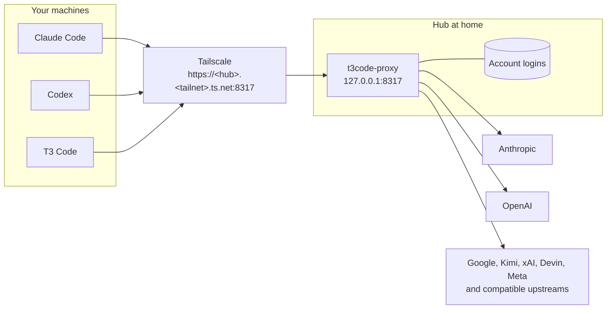
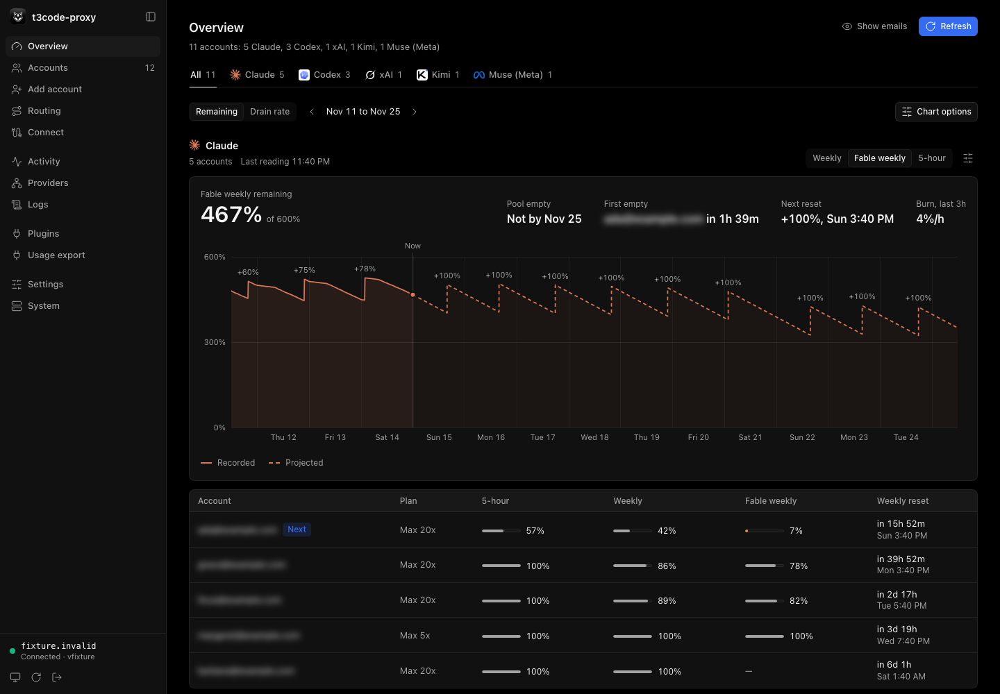

<p align="center">
  <picture>
    <source media="(prefers-color-scheme: dark)" srcset="assets/brand/banner-dark.svg">
    <source media="(prefers-color-scheme: light)" srcset="assets/brand/banner-light.svg">
    
  </picture>
</p>

<p align="center">
  <a href="https://github.com/rune-oai/t3code-proxy/actions/workflows/ci.yml"></a>
  <a href="LICENSE"></a>
</p>

t3code-proxy is a hub for your own AI subscriptions and API-key providers. You run it on one
machine at home that stays on. It holds account logins, keeps OAuth tokens fresh, and exposes
OpenAI-, Claude-, Gemini- and Codex-compatible APIs on port 8317. It serves Claude, Codex,
Antigravity, Kimi, xAI, Devin and Meta accounts, Google API keys and OpenAI-compatible upstreams.
Your other machines reach it over Tailscale. Claude Code, Codex and T3 Code use their normal
client configuration. The panel pools supported limits with plan-aware weights. See
[providers](docs/providers.md) for current coverage. The setup follows Theo Browne's
[token maxing video](https://www.youtube.com/watch?v=D8PikZ1KhUo) and
[gist](https://gist.github.com/t3dotgg/59a521d2ee8d70aaf90e280c175072af). His own hub is private.
This project is an open-source implementation of it.

This project is not affiliated with or endorsed by T3, Anthropic or OpenAI.

**Using subscriptions this way may violate provider terms and can get accounts suspended or
banned. Never serve other people's traffic with your subscriptions. Use Claude subscriptions
only through Claude Code.** Read the [risks and rules](#risks-and-rules) before signing in.

## How it works



The hub listens on loopback only. `tailscale serve` publishes it to your tailnet over HTTPS, so
only devices on your tailnet can reach it. Provider requests leave from the hub's home connection.
T3 Code can run agents on any connected home or cloud [environment](docs/environments.md).

## Features

- **Soonest-reset-first routing.** A new conversation goes to the account whose weekly limit
  resets first, so allowance that would expire unused is spent first. Claude's model-scoped
  weekly caps, such as the Fable and Opus weekly windows, are taken into account. See
  [routing](docs/routing.md).
- **Session affinity.** A conversation stays on one account, so the provider's prompt cache keeps
  working.
- **Codex over WebSockets.** Codex clients that set `supports_websockets = true` use the
  WebSocket transport through the hub.
- **Quota history.** The hub records each Claude and Codex account's quota windows over time.
  The panel's pooled charts support editable plan weights, so accounts on different plans can
  contribute different capacity. See [quota history](docs/quota-history.md) and the
  [provider capability table](docs/providers.md#capability-table).
- **Web panel.** A management panel is compiled into the binary and served at
  `/management.html`: pooled limits and banked Codex reset credits, accounts, sign-in, routing,
  activity, providers, logs and settings, plus a Connect page with ready-to-paste client config
  for Claude Code, Codex and T3 Code.
- **T3 Code support.** T3 Code reads pooled limits from the hub with no plugin. See
  [T3 Code](docs/t3code.md).
- **Environment checker.** `t3code-proxy doctor` checks the network, sleep settings, Tailscale,
  the port, the config, the accounts and the service.
- **Installers and services.** One-line installers for Linux, macOS and Windows set up a systemd
  user unit, a launchd agent or a Scheduled Task. A container image is also published.



## Quick start

On the hub (Linux or macOS; Windows and Docker are in the [setup guide](docs/setup.md)):

```sh
curl -fsSL https://raw.githubusercontent.com/rune-oai/t3code-proxy/main/scripts/install.sh | sh
CONFIG=~/.local/share/t3code-proxy/config.yaml

# Sign in each subscription. You finish each login in a browser.
t3code-proxy -config "$CONFIG" -claude-login -no-browser
t3code-proxy -config "$CONFIG" -codex-device-login

# Publish the hub to your tailnet and check the machine.
tailscale serve --bg --https=8317 http://127.0.0.1:8317
t3code-proxy doctor -config "$CONFIG"
```

The installer writes a client API key into `config.yaml` under `access.api-keys`. On each client,
point Claude Code at the hub in `~/.claude/settings.json`:

```json
{
  "env": {
    "ANTHROPIC_BASE_URL": "https://<hub>.<tailnet>.ts.net:8317",
    "ANTHROPIC_AUTH_TOKEN": "<access key>"
  }
}
```

Then confirm the hub answers from that client:

```sh
curl -s https://<hub>.<tailnet>.ts.net:8317/v1/models -H "Authorization: Bearer <access key>"
```

The [setup guide](docs/setup.md) covers Codex, headless logins, the management secret and a
second config directory that leaves your normal client setup untouched.

## Documentation

- [Setup guide](docs/setup.md): pick a hub, install, sign in, connect clients.
- [Providers](docs/providers.md) covers every login, API-key upstream and current quota capability.
- [Environments](docs/environments.md) covers T3 Code on other machines, including Windows and WSL 2.
- [Set up a box](docs/box-setup.md) gives an ordered agent checklist for a new execution machine.
- [Guide for coding agents](docs/agents.md): for an agent doing the setup on someone's behalf.
- [T3 Code](docs/t3code.md): providers, usage provider and limits.
- [Routing](docs/routing.md): strategies, soonest-reset-first, session affinity, retries.
- [Configuration](docs/configuration.md): the keys a hub owner changes.
- [Quota history](docs/quota-history.md): the recorder and its API.
- [Troubleshooting](docs/troubleshooting.md)
- [Migrating](docs/migrating.md): from CLIProxyAPI or earlier builds of this hub.
- [Development](docs/development.md): repository layout, builds, releases.
- [All documentation](docs/README.md)

## Risks and rules

Using subscriptions this way may violate the providers' terms of service, and accounts can be
suspended or banned. You take that risk. Two rules from the original setup apply:

1. Never serve other people's traffic with your subscriptions. This hub is for your own use.
2. Use Claude subscription models only through Claude Code.

Sign in only from a machine that stays on at home on a residential connection. Do not sign in from
a VPS, a cloud server or through a VPN; Tailscale between your own machines is fine.

## Contributing, security and license

- [CONTRIBUTING.md](CONTRIBUTING.md) explains the development setup and the rules for changes.
- [SECURITY.md](SECURITY.md) explains how to report a vulnerability privately.
- [CODE_OF_CONDUCT.md](CODE_OF_CONDUCT.md) applies to all project spaces.
- Released under the [MIT License](LICENSE). See [NOTICE](NOTICE) for attributions and the
  third-party data sources the hub uses by default.
